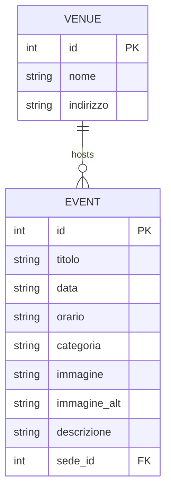

# Data Description --- Segnale Festival

## Data sheet

### 1. Entities

The data model contains two entities: **Event** and **Venue**.

### 2. Fields

#### Event

  -------------------------------------------------------------------------------------------
  Field             Type              Example                               Description
  ----------------- ----------------- ------------------------------------- -----------------
  `id`              Number (integer)  `1`                                   Unique, stable
                                                                            identifier for
                                                                            the event.

  `titolo`          String            `"Lettere in movimento"`              Event title.

  `data`            String (date,     `"2026-06-12"`                        Date of the
                    `YYYY-MM-DD`)                                           event.

  `orario`          String (time)     `"10:00"`                             Starting time of
                                                                            the event.

  `categoria`       String            `"Incontro"`                          Event category.

  `immagine`        String (file      `"assets/lettere-in-movimento.svg"`   Path to the event
                    path)                                                   image.

  `immagine_alt`    String            `"..."`                               Alternative text
                                                                            describing the
                                                                            image.

  `descrizione`     String            `"..."`                               Short description
                                                                            of the event.

  `sede_id`         Number (integer)  `1`                                   Identifier of the
                                                                            venue hosting the
                                                                            event; references
                                                                            `Venue.id`.
  -------------------------------------------------------------------------------------------

#### Venue

  -----------------------------------------------------------------------------------------------
  Field             Type              Example                                   Description
  ----------------- ----------------- ----------------------------------------- -----------------
  `id`              Number (integer)  `1`                                       Unique, stable
                                                                                identifier for
                                                                                the venue.

  `nome`            String            `"Officina Nord — Sede centrale"`         Venue name.

  `indirizzo`       String            `"Corso Duca degli Abruzzi 24, Torino"`   Venue address.
  -----------------------------------------------------------------------------------------------

### 3. Primary keys

The primary key of each entity is `id`, a numeric value that is unique
within its entity and remains stable over time.

### 4. Relationship

One venue can host multiple events, while each event takes place at one
venue. The field `Event.sede_id` references `Venue.id`.

### 5. Quantity

The project contains **six events** and **three venues**.

### 6. Who updates the data and how

The project maintainer updates the data by editing the JSON files in the
project repository (`dati/eventi.json` and `dati/sedi.json`). After the
changes are committed and published to the repository, the website uses
the updated data.

### 7. What the page displays

The Programme page reads the events and venues from the two JSON files
and displays each event as a card. Each card shows the event date, time,
category, title, description, image and the name of the venue hosting
it.

## Event--Venue schema

